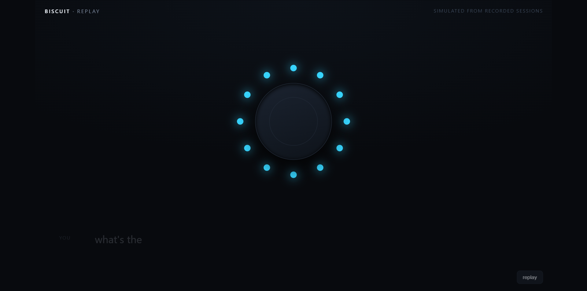

# biscuit

**▶ [Watch the 60-second demo](https://doteyeso-ops.github.io/biscuit/)** — it runs in the browser, no hardware needed.

[](https://doteyeso-ops.github.io/biscuit/)

[](https://github.com/doteyeso-ops/biscuit/actions/workflows/ci.yml)

A self-hosted voice endpoint for a first-generation-rooted **Echo Dot 2 (2016)**.
Press the button, ask a question, get an answer out of the same little speaker —
plus music, a web dashboard and no subscription.

This repository is the **controller**: the software on your computer that the
Dot talks to. It is not a jailbreak and it is not a firmware image.

```
 you ──press──▶ Dot ──16 kHz mic──▶ controller ──▶ answer lanes ──▶ TTS ──▶ Dot speaker
                                     │
                                     ├─ Google "AI Overview"  (via your browser, no API key)
                                     ├─ DuckDuckGo + a model (fallback)
                                     └─ Hermes agent         (house, clock, tools)
```

## What it does

- **Press to talk, press to interrupt.** The button starts a turn; pressing again
  while it is answering cancels the reply mid-sentence, flushes the speaker buffer
  and listens again. You never have to wait out an answer you already know is wrong.
  The ring tells you which state you are in: **cyan = listening, blue spin =
  thinking, green meter = speaking, off = idle.**
- **Push to talk.** The action button opens a bounded, VAD-gated mic turn. The
  device ends the turn itself (`0x04` spoken / `0x05` no speech) with a silence
  fallback, so it never records the room indefinitely.
- **Answers out loud** in two sentences, generated for speech — no markdown, no
  URLs read aloud, no "I'd be happy to".
- **Free answer lanes**, in order: Google's own AI Overview from your signed-in
  browser, then search snippets plus a model, then a full agent with tools.
- **Music** with no ads in the stream: `yt-dlp` takes the audio-only track, so
  there is no ad break to skip in the first place.
- **The ring dances.** While music plays, the 12 LEDs become a three-band
  visualiser — bass on 0–3, mids on 4–7, treble on 8–11 — driven by an FFT of the
  audio actually going to the speaker, about 8 frames a second.


- **Dashboard** at `http://127.0.0.1:8767/ui` — now playing, search and play,
  volume, 3-band EQ, recently played, a **lighting panel** (visualiser on/off, a
  hue wheel, brightness, and seven presets: equalizer, ocean, sunset, forest,
  mono, rainbow, pulse), and toggles for follow-ups and wake word.
- **Survives itself.** A supervisor restarts the controller if it exits, and the
  Dot redials on its own.

## Requirements

| piece | why |
|---|---|
| an Echo Dot 2 (2016), already unlocked | this repo starts where the unlock ends |
| [EchoMuse](https://github.com/wilbowes/EchoMuse) on the device | the emOS userspace + device client |
| Python 3.11+, `ffmpeg` on PATH | controller, audio decode |
| optional: Brave/Chromium | for the Google AI Overview lane |

**Prerequisites are separate projects, by other people, under their own licences.**
You unlock your own hardware with [firebreak](https://github.com/W1CT0R/firebreak),
you flash emOS with EchoMuse, and then this controller plugs into it. See
[NOTICE.md](NOTICE.md) and [docs/LEGAL.md](docs/LEGAL.md) — read the legal note
before you start.

## Runs with what you already have

Nothing here requires my exact setup. Every piece below is optional, and the
controller degrades instead of failing when it is missing.

| you have | what you get |
|---|---|
| an OpenAI-compatible endpoint (`DOT_LLM_URL`) | the agent lane: OpenAI, Groq, vLLM, LM Studio, llama.cpp server, Ollama's `/v1` |
| a local `hermes` CLI | the agent lane with tools and household memory |
| a browser you can start with a debug port | Google's own answer overview, no key |
| none of the above | search snippets + a model if one is configured, otherwise time, date and music |
| nothing at all | time, date, music, and "I can't answer that yet" |

That last row is deliberate: a machine with no keys, no browser and no model
still gets a working speaker rather than a stack trace.

## If your setup is messy

Most of the friction in this project came from assumptions, not code. So:

- **No API keys?** `PERSONA` and `_local_answer` need none. Music and the clock
  work offline.
- **Different model?** Set `DOT_LLM_URL` to anything OpenAI-shaped. The persona
  prompt is one string at the top of `controller.py`.
- **Already running Home Assistant?** This is not an HA add-on; it is a second
  controller speaking the same device protocol. Run one or the other against the
  Dot, not both at once.
- **No Brave?** The Google lane is skipped, the snippet lane answers instead.
  `DOT_DISABLE_GOOGLE=1` does the same thing on purpose.
- **Not a Dot 2?** Only the Dot 2 on emOS has been tested. Other boards announce
  a different capability list; expect to adapt the protocol calls.
- **Two controllers on one machine?** Allowed — set `DOT_PORT`. mDNS may refuse
  the second name and the controller logs it and carries on.
- **Windows, macOS, Linux?** The controller is plain asyncio; the only
  OS-specific part is the `ffmpeg` path, which is an env var.

## Try it without an Echo

```bash
python controller.py --simulate
# then open http://127.0.0.1:8767/ui
```

`--simulate` attaches a fake device that speaks the real protocol: the dashboard
is live, the ring visualiser renders, music resolves and streams, and the audio
goes nowhere. It is there so you can see whether this is worth doing before you
own a rooted Dot — and because a repo you can't run is a repo you don't trust.

What it does not simulate: the button, the microphone, the speaker, and the
device's output guard.

## It listens on your network

Port `8767` is bound on the LAN because the Dot has to reach it. That means the
dashboard and the JSON API are reachable by anything on your network unless you
set a token:

```bash
DOT_UI_TOKEN=$(python -c "import secrets;print(secrets.token_urlsafe(18))")
```

Then `/ui?t=<token>` works and everything else gets `401`. The device sockets
(`/control`, `/data`, `/shell`) stay open — the device cannot send a header, and
binding them to loopback would mean the Dot could not connect at all.

Copy [`.env.example`](.env.example) for the full set of variables.

## Install

```bash
git clone <this repo> biscuit && cd biscuit
python -m venv .venv && . .venv/bin/activate      # Windows: .venv\Scripts\activate
pip install -r requirements.txt
```

Point it at your Dot's controller address — the device dials *you*, so the
controller must be reachable on the LAN:

```bash
export DOT_PYTHON=$(which python)        # interpreter the supervisor should use
./scripts/run_controller.sh              # or: python supervise.py
```

Then open <http://127.0.0.1:8767/ui>.

## Configuration

Everything comes from the environment; nothing secret is stored in the repo.

| variable | default | meaning |
|---|---|---|
| `DOT_PORT` | `8767` | controller HTTP/WebSocket port |
| `DOT_PYTHON` | current interpreter | what `supervise.py` launches |
| `DOT_ENV_FILE` | unset | optional `.env` holding provider keys |
| `FFMPEG` | `ffmpeg` | ffmpeg binary |
| `VOICE_FOLLOWUPS` | `0` | extra turns after one press |
| `MUSIC_GAIN_DB` | `0` | pre-guard gain for music |
| `ALWAYS_ON` | `0` | wake-word listening instead of the button |
| `DOT_LLM_URL` | unset | OpenAI-compatible endpoint for the agent lane |
| `DOT_LLM_KEY` | unset | bearer token for that endpoint, if it wants one |
| `DOT_LLM_MODEL` | `gpt-4o-mini` | model name sent to it |
| `DOT_LLM_TIMEOUT` | `25` | seconds before the lane is abandoned |
| `DOT_DISABLE_GOOGLE` | unset | set to `1` to skip the browser lane entirely |

The dashboard writes `dot_config.json` (EQ, toggles) and `music_history.json`
beside the controller. Both are gitignored.

## See it without the hardware

`docs/index.html` — a 60-second replay of the real interaction (labelled as
a simulation): press, question, answer, music, dashboard. Open it in a browser.

## Status

Working end to end on a Dot 2 running emOS: button turns, spoken answers, music,
dashboard. Known rough edges are in [docs/ARCHITECTURE.md](docs/ARCHITECTURE.md#known-limits).

## Credits

The device side is not mine: **EchoMuse** (MIT, Wil Bowes) provides emOS and the
device client, **firebreak** performs the unlock, and this controller speaks the
protocol they document. Music extraction is **yt-dlp**; speech is
**faster-whisper** and **Piper**; the web layer is **aiohttp**.

## Licence

MIT for the code in this repository — see [LICENSE](LICENSE).
